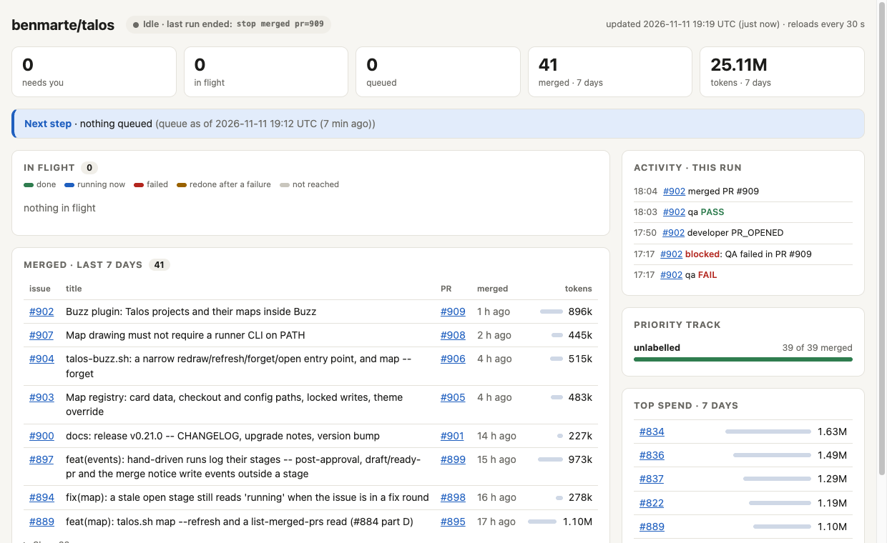
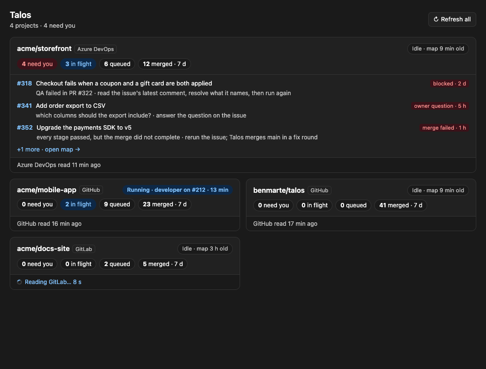
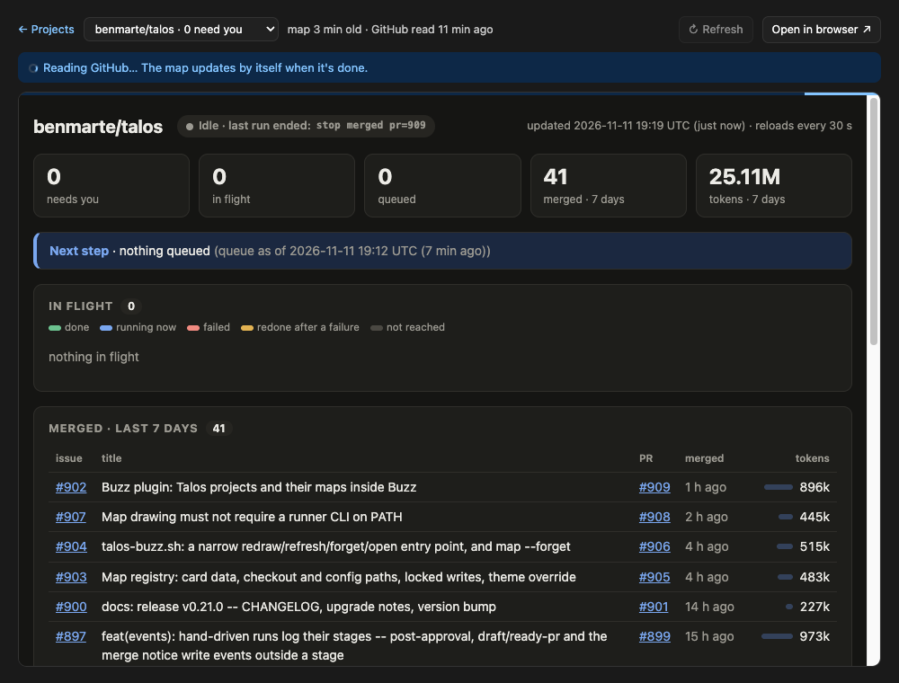

# Talos

> *The bronze automaton that patrols your backlog.*

Talos is an agnostic **issue-to-PR orchestrator**. Label an issue `pipeline:ready` and Talos walks it through validator, spec, developer, docs, review, security, QA and a squash merge, with your own test commands as the gate. It keeps nothing resident: the state lives in labels and comments on the issue and PR, plus a local events log.

It is code-driven by default: `/talos:pipeline` starts `scripts/talos.sh run`, the deterministic orchestrator, once. Code decides the next step, runs the gates and calls the model only for the stage work itself; the session acts only when the driver stops on something that needs judgment. `execution.orchestrator: llm` opts back into the loop where the session dispatches each stage as a subagent.

- **Trackers:** GitHub (the `gh` CLI or a token), GitLab, Azure DevOps, or a local `plan.md` checklist.
- **Harnesses:** Claude Code natively; pi, Codex CLI, Gemini CLI, Antigravity, or any agentic CLI (including a local llama.cpp model) as the stage runner.
- **Notifications:** Slack, Discord, Teams, Buzz and a generic command sink.
- **Safe by default:** approvals bound to the PR head SHA, draft PRs with one CI run that works in parallel with the final QA (`ci.parallel_with_qa`; the CI gate is `merge.required_checks`, for example one aggregate `ci-complete` job), a forbidden-files gate, secrets only by reference, and an opt-in token budget guard (`limits.tokens_per_issue`, unset by default).

## How it works

An issue moves by label: `pipeline:ready` (you queue it), validator, PM spec, developer (opens the PR), then docs, reviewer and security, QA, and the merge. Each stage is a fresh agent that posts its verdict as a comment and an approval label bound to the PR head SHA; code, not an LLM, routes between stages, runs the gates and merges. With draft PRs (the default) review runs on the draft, a single fix round covers all findings, and CI runs once before QA. Every stage except the developer can be switched off with `roles.*`, and only a person queues work, clears a block or merges when `merge.auto` is false.

For specs that touch risky ground, list the areas in `pipeline.risk_areas` (for example `["tenant data", "auth/authz/MFA", "credentials", "isolation", "migrations", "egress", "approval/go-live gates"]`; empty by default, which switches this off). An issue whose title, body or spec names one gets a `threat` stage between the PM spec and the developer: the security agent reads the spec, not code, and appends a `## Threat model` section of `(test)` criteria that the developer proves with tests and QA maps like the PM's. Details: [Threat model before the build](docs/reference.md#threat-model-before-the-build).

## Install

Claude Code plugin (installs the required [agent-skills](https://github.com/addyosmani/agent-skills) plugin as a dependency):

```
/plugin marketplace add benmarte/talos
/plugin install talos@talos
```

Any harness, or to share one copy across repos:

```bash
git clone https://github.com/benmarte/talos
bash talos/install.sh --global     # installs to ~/.talos (re-run after git pull)
```

Needs `bash`, `git`, `python3`, and the CLI of your tracker (`gh` for GitHub). Details: [Install and setup](docs/reference.md#install-and-setup). Upgrading: [from v0.21](docs/reference.md#upgrading-from-v021), [from v0.20](docs/reference.md#upgrading-from-v020), [from v0.19](docs/reference.md#upgrading-from-v019), [from v0.18](docs/reference.md#upgrading-from-v018).

## Quickstart

```bash
bash talos/install.sh /path/to/repo           # per-repo setup; then copy talos.pipeline.json.example (or run /talos:setup)
bash ~/.talos/scripts/bootstrap-labels.sh     # from inside the repo (needs install.sh --global): creates the pipeline:* labels
gh issue edit 42 --add-label pipeline:ready   # queue an issue
```

Then, in Claude Code, inside the repo:

```
/talos:setup       # once: detects your provider and test command, writes the config
/talos:pipeline    # drives the queue; re-run it to resume after a stop
```

Without Claude Code: `bash ~/.talos/scripts/talos.sh run` (the same driver `/talos:pipeline` starts), or tell any agentic CLI `Read ~/.talos/skills/pipeline/SKILL.md and follow it`. A minimal config is `{ "base_branch": "main", "verify": ["npm test"] }`; every key is in the [config reference](docs/reference.md#config-key-reference). `talos.sh run` also works from a Claude Code cloud session (claude.ai/code) on a GitHub repository, without the project board: [Running in a Claude Code cloud session](docs/reference.md#running-in-a-claude-code-cloud-session).

## Repo guides: REVIEW.md and VERIFY.md

Two optional files on your base branch tell the stages what you know about the repo. `REVIEW.md` (what failure looks like here, paths to skip, how to report) goes into the reviewer, security and adversarial prompts; `VERIFY.md` (how to start the app, which specs cover which area, flaky checks) goes into the QA prompt. Both are repo guidance below Talos's own rules: they can narrow or add checks, never turn off a gate. Start from [templates/REVIEW.md.example](templates/REVIEW.md.example) and [templates/VERIFY.md.example](templates/VERIFY.md.example); the details are in [docs/reference.md](docs/reference.md#repo-guides-reviewmd-and-verifymd).

## Status line

`install.sh --global` wires Claude Code's status line to `scripts/talos-status.sh` (an existing one is chained, shown above the Talos line, and `--statusline-undo` restores it), which reads the local events log (no network call, no model tokens):

```
talos #7 qa ●●●●◐○ 3.41M · cache read 48.20M · map · board
```

One dot per stage (validator, pm, developer, review, qa, merge): done, running, pending, then the tokens spent on the issue so far, then its cache reads, which are not part of that total (the part is absent when no run recorded them). The line ends with clickable [OSC 8](https://gist.github.com/egmontkob/eb114294efbcd5adb1944c9f3cb5feda) `map` (the project map page) and `board` links, built offline; `board` needs the optional `board.url` on GitHub (Azure DevOps and GitLab derive it), and `TALOS_STATUSLINE_LINKS=0` turns the links off. In a repo with a Talos config and no active issue it prints `talos idle` plus the links. Other harnesses can call `talos-status.sh --line` from their footer hook. After a cleared session or an LLM switch, run `/talos:pipeline` (or `talos.sh run`) again: the work is resumed from GitHub labels, the PR and the events log, with no extra file to maintain. See [Hooks, events, spend and the status line](docs/reference.md#hooks-events-spend-and-the-status-line).

A repository driven by hand from a Claude Code session (stage agents dispatched as subagents, no `talos.sh run`) gets its tokens into the status line, the map and `cost` through the plugin's `SubagentStop` hook, or by running `pipeline-events.sh import-usage` over the session's transcripts; the map shows `not recorded`, never 0, when nothing was recorded (see [the events log](docs/reference.md#the-events-log)).

`talos.sh map` renders a one-page [project map](docs/reference.md#project-map) of the queue (the [Buzz plugin](docs/reference.md#buzz-plugin) shows every project and its map inside Buzz), `talos.sh evidence prune` removes the QA evidence of finished PRs from the [`talos-evidence` branch](docs/reference.md#evidence-storage) in one commit, and `agents.claude_api_credits: true` lets claude stages on a Max or Team plan start on its [monthly API credits](docs/reference.md#monthly-api-credits).

## Project map

Every repository Talos works on gets a one-page map in your browser: what needs you, what's in flight and at which stage, what merged in the last 7 days and what it cost in tokens. It's a plain HTML file. It needs no server, no login and no Buzz, and it reloads itself every 30 seconds.



**Opening it:**

- **From the status line:** the Talos status line ends with a clickable `map` link (see [Status line](#status-line)). Cmd-click it (Ctrl-click on Linux) in any terminal that supports links, such as iTerm2, Ghostty, WezTerm, kitty or VS Code.
- **By hand:** run `talos.sh map` in the repo. It prints the page's path:
  - `~/.talos/maps/<owner>-<name>.html` is this repo's map;
  - `~/.talos/maps/index.html` links every repo's map.

  Open either one with `open <path>` on macOS or `xdg-open <path>` on Linux.
- **cmux users:** cmux opens Cmd-clicked files in its own preview. Set `"app": { "openSupportedFilesInCmux": false }` in `~/.config/cmux/cmux.json` to open the map in your browser instead.

**Keeping it current:**

- **During a run:** `talos.sh run` (or `/talos:pipeline`) redraws the map at every stage.
- **Without a run:** `talos.sh map` redraws it from local records, with no network call. `talos.sh map --refresh` also reads GitHub, Azure DevOps or GitLab first, which helps when the work ran in another checkout or environment.

Details are in [docs/reference.md](docs/reference.md#project-map).

## Buzz plugin

If you use [Buzz](https://github.com/block/buzz-app), the Talos plugin shows every project on your Mac, and each project's map, in a Buzz page. A badge on its sidebar row counts the items that need you.



**Install it:**

1. Run `bash install.sh --global`. It writes the plugin to `~/.talos/buzz-plugin/`.
2. In Buzz, open **Settings → Plugins → Manage plugins → Load from folder**. Press ⌘⇧G, paste `~/.talos/buzz-plugin` and choose the folder.
3. Approve the access review. It lists two things:
   - reading files (the Talos maps in `~/.talos/maps`);
   - one process, `talos`, which runs `~/.talos/scripts/talos-buzz.sh`. That script can only redraw, refresh, forget or open a project's map, or open a link that map shows; it can't start a run.
4. Open **Talos** in the sidebar.

A project appears after Talos draws its map once: run `talos.sh map` in the repo, or start a Talos run there.

**Using it:**

- **Cards:** projects that need you come first, with the top three items (each opens its issue), then running projects.
- **Project view:** click a card to see its map. **Refresh** redraws it and reads GitHub, Azure DevOps or GitLab again with Talos's own `gh`, `az` or `glab` login. The page updates by itself when the read finishes. **Open in browser** opens the same map in your browser.
- **Theme:** the plugin follows Buzz's light or dark theme.



The plugin holds no token and makes no network call of its own. **After you upgrade Talos**, run `install.sh --global` again and load the folder in Buzz again, so Buzz picks up the new `plugin.js`. The refresh rules and the security model are in [docs/reference.md](docs/reference.md#buzz-plugin).

## Switching LLMs: profiles

A profile bundles a mode, a runner, a model and per-role overrides under one name. Select one with `agents.profile` or per run with `TALOS_PROFILE`; `agents.fallback` lists what to switch to when a provider is down.

```json
{ "agents": { "profile": "claude", "fallback": ["local"],
  "profiles": {
    "claude": { "mode": "native", "model": "sonnet", "roles": { "security": { "model": "opus" } } },
    "local":  { "runner": "pi", "mode": "inline", "model": "glm-5.3-flash" }
} } }
```

```bash
TALOS_PROFILE=local bash ~/.talos/scripts/talos.sh run
```

An unknown profile name stops the run instead of silently using another one. See [Profiles, runners and fallback](docs/reference.md#profiles-runners-and-fallback).

## Documentation

- [docs/reference.md](docs/reference.md): everything else. How a run works, install per harness, configuration and secrets, the generated config key tables, profiles and runners, providers and the board, isolation and multi-user claims, gates, notifications, hooks and events, troubleshooting.
- [Evidence storage](docs/reference.md#evidence-storage): QA's e2e screenshots and videos (`verify.e2e_artifacts`) live on the `talos-evidence` branch of your repository on every provider; how it grows and how to clean it up.
- [CHANGELOG.md](CHANGELOG.md): one line per change.
- [skills/pipeline/SKILL.md](skills/pipeline/SKILL.md): the orchestrator playbook; [agents/](agents/): the nine stage role profiles.
